<a href="https://savasbuilds.com">
  <picture>
    <source media="(prefers-color-scheme: dark)" srcset="assets/banner-dark.svg">
    
  </picture>
</a>

  
  
  

### Hi, I'm Ömer 👋

Qualified application developer (*Fachinformatiker für Anwendungsentwicklung*) from Cologne. I build full-stack web apps – from the database to the interface – with a focus on **TypeScript, Vue/Nuxt and React**, and I care about clean code and interfaces that feel good to use.

- 🛠️ Building my own products like **Your Dictionary** and **Sumi**
- 🤖 Working with AI in my daily workflow – Claude Code, Codex, agentic workflows and AI-assisted code review
- 🎮 Hobby: 3D modelling, meshing, rigging and game design with AI

### ✨ Featured projects

<table>
  <tr>
    <td width="50%" valign="top">
      <h4><a href="https://dictionary.savasbuilds.com">📖 Your Dictionary</a></h4>
      A personal dictionary for language learners: collect words, explain them in your own words and practise with flashcards.  
      <code>Nuxt</code> <code>Vue</code> <code>TypeScript</code> <code>Supabase</code> <code>PostgreSQL</code>  
      <a href="https://dictionary.savasbuilds.com"><b>Live ↗</b></a>
    </td>
    <td width="50%" valign="top">
      <h4><a href="https://sumi.savasbuilds.com">🌸 Sumi</a></h4>
      A full-stack platform to discover and track anime, built on top of the AniList GraphQL API.  
      <code>Next.js</code> <code>TypeScript</code> <code>Supabase</code> <code>TanStack Query</code> <code>GraphQL</code>  
      <a href="https://sumi.savasbuilds.com"><b>Live ↗</b></a> · <a href="https://github.com/nilvaes/sumi">Code</a>
    </td>
  </tr>
  <tr>
    <td width="50%" valign="top">
      <h4><a href="https://bosporus-pide.com">🥙 Bosporus Pide</a></h4>
      Website for a Turkish restaurant in Cologne – with menu, catering and a bilingual DE/TR interface. Client project.  
      <code>React</code> <code>TypeScript</code> <code>Vite</code> <code>Tailwind CSS</code>  
      <a href="https://bosporus-pide.com"><b>Live ↗</b></a>
    </td>
    <td width="50%" valign="top">
      <h4><a href="https://github.com/nilvaes/switch-audio">🔊 Switch Audio</a></h4>
      A lightweight Windows tray app that switches between two audio outputs with a global hotkey. Builds and releases the <code>.exe</code> with GitHub Actions.  
      <code>C#</code> <code>.NET</code> <code>WinForms</code> <code>Win32 API</code> <code>GitHub Actions</code>  
      <a href="https://github.com/nilvaes/switch-audio/releases/latest"><b>Download ↗</b></a> · <a href="https://github.com/nilvaes/switch-audio">Code</a>
    </td>
  </tr>
</table>

<a href="https://savasbuilds.com/#projects">See all projects on my portfolio →</a>

### 🧰 Tech stack

  

### 📫 Let's talk

Open to job offers, project ideas or just a chat about web development – reach me on [LinkedIn](https://www.linkedin.com/in/savasdev/) or [Xing](https://www.xing.com/profile/Oemer_Savas094643).
